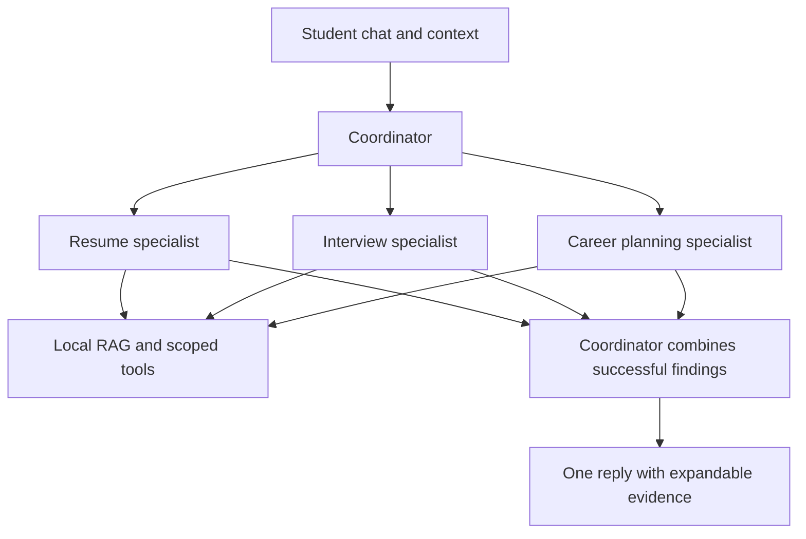

# Career Compass multi-agent edition — 0.7.1

This repository contains the multi-agent interface and Node backend. GitHub Pages serves static assets; the configured hosted backend is deployed separately. No API credentials are included.

## What makes it multi-agent

A model-driven career coordinator calls three separately instructed, independently executed specialist model loops as tools. This is a manager pattern implemented directly with the Responses API, rather than buttons or a keyword router. All agents currently use the same configurable model (gpt-4.1-mini by default); their instructions, tool scope and execution loops distinguish them. No Agents SDK dependency is needed.

| Agent | Role | Permitted tools |
| --- | --- | --- |
| Coordinator | Select tasks and synthesize one reply | consult_resume, consult_interview, consult_career |
| Resume specialist | Truthful resume review and job evidence | search_guidance, review_resume, compare_resume_job |
| Interview specialist | Requested answer drafts and explicit mock practice | search_guidance, review_interview_answer |
| Career planning specialist | Role exploration and practical plans | search_guidance, create_plan |

## Context, retrieval and evidence

Each specialist receives the original request, validated resume/job context, profile and last 20 conversation messages. The coordinator task is labelled as a task, not new student facts. Specialists have separate tool histories and must retrieve guidance before returning findings. With sufficient resume text, the resume specialist must then complete compare_resume_job when job context is available, or review_resume when only a resume is available. The runtime and API tool selection both enforce this before generation; failed tools do not count as completed evidence checks. The coordinator receives completed findings and their selected source records. Source IDs are checked against those records at both layers. Validation does not prove claim support, relevance, factual accuracy or perfect resistance to prompt injection.

Sources and actual agent/tool traces stay collapsed below replies. No fabricated progress or private model reasoning is displayed. Browser history and document extraction are preserved.

## Bounded execution and failures

- At most 16 model calls: up to four coordinator decisions plus four for each of three specialists.
- Each specialist can be consulted once per request. Specialists cannot delegate.
- Calls run sequentially; the API disables parallel function calls.
- Tools are unavailable on the final decision of each loop.
- Output limits: 1,200 tokens per specialist call and 1,500 per coordinator call. These are output caps, not dollar caps; documents and replayed context increase input usage.
- Targeted draft checks can request revisions within the same call budget; they are not comprehensive factuality checks.
- Local HTTP timeout is 120 seconds. Cancellation propagates via the shared abort signal.
- Failed specialists contribute no findings or sources. Successful work can be returned with an explicit unavailable-part notice. If all consulted specialists fail, the request fails visibly.
- Authentication, quota, connectivity and total-budget errors stop the whole request. There is no fabricated AI fallback.
- Existing limits of two concurrent requests, 20/minute and 60/day remain per process; they reset on restart and are not durable quota controls.

## Running and comparing

Run Setup-API-Key.cmd with your own key, then Start-Career-Compass.cmd. Open http://127.0.0.1:4177. With Node on the path, `node serve.mjs` also works. No npm install is needed. Never include `.env` in shared ZIPs or Git.

For a single-agent comparison, set CAREER_COMPASS_AGENT_MODE=single-agent in the server process environment before starting. The isolated edition defaults to multi-agent. Status reports the architecture. Both use the same validation, retrieval corpus and model configuration.

Without a key, practice mode uses local templates and is not a simulated multi-agent run. Confirm the hosted backend status reports architecture=multi-agent before presenting the public app as multi-agent.

## Assignment alignment and remaining work

Student career needs, document entry/upload, RAG, tools, AI-assisted coding and the chat interface are retained. This edition adds model-selected specialist delegation and observable execution traces. The online requirement depends on the GitHub Pages interface and the separately deployed compatible backend both remaining accessible.

Before replacing the public version: review generated advice, test with students, check mobile/attachment workflows, compare usefulness/cost/latency against the baseline, deploy a compatible backend and verify frontend/backend together. More agents do not establish better results. Present only the version actually submitted and demonstrated.

Official references: [orchestration](https://developers.openai.com/api/docs/guides/agents/orchestration), [function calling](https://developers.openai.com/api/docs/guides/function-calling).
