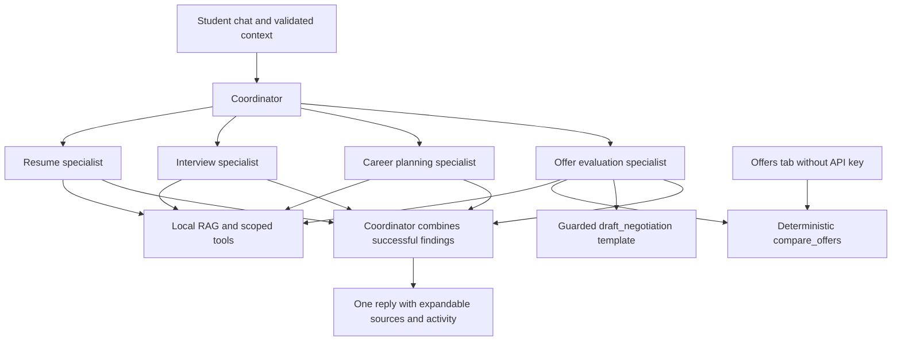

# Stride multi-agent architecture — 0.11.3

GitHub Pages serves the static interface. A separately hosted backend calls the OpenAI Responses API. The professor can instead download the project, put their own key in a private .env beside serve.mjs, and run Start-Stride.cmd. No new npm dependencies were added.

## Agent team

One coordinator selects among four independently instructed specialist loops. All use the configured model, gpt-4.1-mini by default. Different instructions, tool permissions and isolated histories define their roles; the coordinator synthesizes successful findings. No Agents SDK is required.

| Agent | Scope | Permitted tools |
| --- | --- | --- |
| Career coordinator | Route tasks and synthesize findings | consult_resume, consult_interview, consult_career, consult_offer |
| Resume specialist | Truthful resume review and job evidence | search_guidance, review_resume, compare_resume_job |
| Interview specialist | Requested drafts and explicit mock practice | search_guidance, review_interview_answer |
| Career planning specialist | Role exploration, plans, live jobs and employer research | search_guidance, create_plan, search_jobs, research_employer |
| Offer evaluation specialist | Student-supplied compensation comparisons and negotiation drafts | search_guidance, compare_offers, draft_negotiation |

## Context and evidence

Original request, validated resume/job/profile/offer context and the last 20 conversation messages are untrusted data. Coordinator tasks and retrieved examples cannot establish student facts. The same offer validator handles the Offers form, explicit offer JSON in chat and backend requests. Unknown offer terms become Not listed. The Offers tab stores up to four offers in the existing browser workspace; no account sync. Choosing Discuss attaches them to the current chat, whose context is restored when reopened. A new chat clears its attached offers. Natural-language offer letters are conversation data; the form or explicit JSON supplies deterministic inputs.

Every specialist retrieves guidance first. The resume specialist must then complete compare_resume_job when both documents are supplied, or review_resume when only the resume is available. The offer specialist must complete compare_offers when at least one supplied offer includes a base salary. Both the loop and provider tool selection enforce required evidence. Failed tools do not satisfy it. The coordinator routes offer/compensation/negotiation requests to consult_offer; combined offer-and-onboarding-plan requests require both consult_offer and consult_career.

Six new original summaries cover compensation, equity/cliffs, negotiation, deadlines, benefits and student priorities, with source URLs and review dates. BM25 retrieves guidance locally. Source IDs are checked against completed retrieval/consultation records at both layers; this does not prove every claim is supported. Sources and actual tool events remain expandable. consult_offer, search_guidance and compare_offers appear in the activity trace; no fabricated progress or private reasoning is exposed.

## Offer math and tool safety

compare_offers accepts 1–4 offers with allowlisted fields. It rejects negative/non-numeric amounts, base salary above $2M, conflicting bonus amount/percentage inputs, invalid dates and unsupported fields. It uses USD and deterministic arithmetic; the model must not estimate market salaries or recompute totals. Annual bonus comes from either an explicit amount or supplied target percentage. Signing and relocation count once. Equity assumes linear vesting with catch-up at the supplied cliff; vesting duration defaults to four years with an explicit assumption. Unknown cliff terms are not guessed. Retirement assumes employee contributions up to the supplied cap and applies the supplied employer match rate. Verify actual vesting/plan terms.

Complete totals remain Not listed when a monetary component is unknown; separately labelled disclosed subtotals show known components. Complete packages are ranked by year-one and COL-adjusted year-one values. Differences are leader minus each offer, with percentage using that offer’s value as denominator; zero denominators remain Not listed. The tool never chooses an offer. Four-year projections assume constant salary/target bonus and equity value, continued service and full years, not tax, raise or liquidity forecasts.

The bundled public BEA snapshot is 2024 all-items Regional Price Parities for 30 metros, released 2026-02-19 and checked 2026-11-05. Remote (US) explicitly uses national reference 100, not actual residential costs. Unknown locations receive no adjustment. **Not financial or legal advice; the COL table is approximate and dated.** Flags request verification of expiry, equity schedules, signing clawbacks, bonus/PTO, relocation and employment terms.

draft_negotiation uses a short application-owned first-person template. The selected offer must exist. Reasons and requested ask must occur verbatim in original student messages; unsupported personal claims and asks become bracketed placeholders. It invents no market salary. Specialist and coordinator rewrites cannot replace the protected tool draft with embellished claims. Nothing is emailed or accepted automatically. Student-provided statements remain self-reports, not independently verified facts.

## Unchanged execution limits and failures

- At most 16 model calls globally, including existing live research calls.
- At most three sequential, unique specialist consultations, even though four specialists are available. Each specialist can be consulted once and cannot delegate.
- Four coordinator decisions and four decisions per specialist. Tools unavailable on each loop’s last decision.
- Output caps: 1,200 tokens per specialist call and 1,500 per coordinator call. These are not billing caps.
- HTTP timeout 120 seconds; cancellation propagates through the shared abort signal.
- Failed specialists contribute no findings or sources. Successful portions may return with a clear unavailable-part notice. All-specialist failure, authentication/quota or global-budget failure stops the request.
- Two concurrent requests, 20/minute and 60/day per process/isolate remain; counters reset and are not durable spending controls.

## Single-agent baseline and offline mode

CAREER_COMPASS_AGENT_MODE=single-agent retains the same validation, corpus, model and compare_offers / draft_negotiation tools. Required offer evidence and protected drafts also apply there; no delegation is added. Without a key, deterministic Offers calculations and storage work fully. General practice chat is template-based, not a live multi-agent run. AI discussion, negotiation drafting through chat, live jobs and employer research require the downloaded local backend and a private .env. Public visitors may explicitly supply a per-tab OpenAI key; local copies can instead use a private .env. Neither path enables public owner-key fallback. Hosted requests never fall back to the owner key.

## Verification

Run node --test tests/*.test.mjs. See [Offer-Specialist.md](../evaluation/Offer-Specialist.md) for recorded step results, fictional arithmetic examples, actual offline browser QA and limitations. Mock protocol tests do not establish live-model quality, user usefulness or better outcomes than the baseline. Student feedback and a paid live offer-model evaluation remain optional follow-up evaluation, not claimed completed work.

## Public visitor key dialog

The reference-style OpenAI dialog masks input and keeps accepted keys in the existing createTabKey closure. It has Use key for this tab, Clear key and Cancel actions. No persistent browser storage or serialized getter is used. Inputs clear on submission/cancellation/dialog close, and tab keys clear on page exit/refresh, cached-page restoration or provider authentication rejection. Existing source-context and history serialization excludes credential state.

The frontend sends visitor credentials only in Authorization headers to the configured AI service. The service validates the request-scoped key and forwards it to OpenAI; it never substitutes the owner key on public requests. Visitors must trust the frontend and service, and their own API projects pay for usage. Format validation is not an authentication or billing check. The first AI request verifies actual API access. Local .env configuration remains optional and is not read by GitHub Pages. The unpublished public-to-local demo connection has been removed in favor of this direct public-site workflow.

## Resume Optimizer tab
The dedicated optimizer collects a resume and target job, passes them through the existing context validation and coordinator request, and asks for consultation with the existing resume specialist. No new agent or permissions are introduced. The specialist retains its existing required evidence tools and instruction scope. The tab displays the returned answer as text, supports copy/plain-text download, and links to the originating chat. It does not submit applications or calculate a claimed ATS score.
